# 저장·보안 확인 기록

로컬(SQLite)과 클라우드(Supabase)에서 각각 데이터가 저장되는지, Supabase 전환 뒤 RLS(행 수준 보안)가 제대로 막는지, 그리고 로컬 버전의 명령줄 도구(CLI)가 제대로 동작하는지 확인한 기록입니다.

- 확인 날짜: 2026-11-02 (1~4장: 2026-10-29, 5장 캡처: 2026-11-01, 6장 CLI·7장 AI 연동 캡처: 2026-11-02)
- 확인 스크립트는 저장소에 있으므로 누구나 다시 돌려 볼 수 있습니다. ([다시 확인하는 방법](#다시-확인하는-방법))
- 스크립트 출력 원문: [docs/results/verify_local.txt](docs/results/verify_local.txt), [docs/results/verify_supabase.txt](docs/results/verify_supabase.txt), [docs/results/verify_cli.txt](docs/results/verify_cli.txt)

## 요약

| 확인 항목 | 방법 | 결과 |
|---|---|---|
| 로컬(SQLite) 저장 | [tests/verify_local.py](tests/verify_local.py): 추가·완료·삭제 후 서버를 껐다 켜서 비교 | ✅ 10/10 통과 |
| Supabase 저장 | [tests/verify_supabase.py](tests/verify_supabase.py) 1~2부: 같은 확인 + Supabase에 저장된 행과 소유자 확인 | ✅ |
| RLS: 로그인 안 한 요청 차단 | 같은 스크립트 3-1부: anon 키만으로 테이블, 뷰, 함수 7건 호출 | ✅ 7건 모두 401 |
| RLS: 다른 사용자 데이터 차단 | 같은 스크립트 3-2·3-3부: 사용자 B가 백엔드 경유 4건, Supabase 직접 호출 8건으로 A의 데이터 접근 | ✅ 12건 모두 차단 |
| Supabase 스크립트 전체 | | ✅ 35/35 통과 |
| 배포 사이트 | https://todos-g3b4.onrender.com/ 에서 로그인 없이 API 호출, 화면 코드에 키 포함 여부 | ✅ 401, 키 없음 |
| 로컬 CLI(`todo_cli.py`) | [tests/verify_cli.py](tests/verify_cli.py): 복사본에서 list·add·done·summary 실행, 잘못된 입력 거부, 웹 화면 반영, 실데이터 보호 | ✅ 15/15 통과 |
| AI가 CLI·스킬로 데이터 읽기 | 새 대화에서 Claude Code에 요청하고 화면 캡처 (7장) | ✅ 규칙 파일 읽음, 승인창 확인, 삭제 거부, 스킬 2개 발동 |

---

## 1. 로컬(SQLite) 저장 확인

**대상:** [local-sqlite/](local-sqlite/) (PRD v1 버전. 데이터는 `todo.db` 파일 하나에 저장)

**방법:** 스크립트가 v1 앱을 임시 폴더에 복사해 **실제 서버를 띄우고**, 화면에서 버튼을 누를 때와 같은 요청을 보냅니다.
1. 할 일 3건 추가 (마감일, 태그 포함) → 1건 완료 표시 → 1건 삭제
2. 그 시점의 `todo.db` 내용을 기록하고 **서버 프로세스를 종료** (접속 불가 확인)
3. **서버를 다시 시작**해 `todo.db`와 목록 화면이 끄기 전과 같은지 비교

**결과:** 10/10 통과

```
== 1회차 실행: 추가 / 완료 / 삭제 ==
PASS 서버 시작 시 todo.db 파일 생성
PASS 추가 3건이 목록에 보임
PASS 완료 표시 -> 완료 목록에 보임
PASS 삭제 -> 목록에서 사라짐
PASS 태그 필터
  [todo.db 의 todos 테이블]
    (1, '보고서 작성', '2026-11-05', '2026-10-29 14:06:07', None, '업무, 긴급')
    (2, '운동하기', None, '2026-10-29 14:06:07', '2026-10-29 14:06:07', '건강')

== 서버 종료 ==
PASS 서버가 꺼짐 (접속 불가)

== 2회차 실행: 다시 켜서 확인 ==
  [todo.db 의 todos 테이블]
    (1, '보고서 작성', '2026-11-05', '2026-10-29 14:06:07', None, '업무, 긴급')
    (2, '운동하기', None, '2026-10-29 14:06:07', '2026-10-29 14:06:07', '건강')
PASS 다시 켠 뒤 DB 내용이 끄기 전과 같음
PASS 다시 켠 뒤 목록에 그대로 보임
PASS 완료 상태와 완료일자 유지
PASS 태그 유지
```

열 순서: id, 제목, 마감일, 생성일자, 완료일자, 태그 (시각은 UTC)

## 2. Supabase 저장 확인

**대상:** 현재 버전 (루트 폴더). 실제 Supabase 프로젝트에 연결

**방법:** 로컬 확인과 같은 순서로 하되, 로그인한 사용자로 진행합니다.
1. 실제 백엔드 서버를 띄우고 테스트 사용자 A로 로그인 → 할 일 3건 추가 → 1건 완료 → 1건 삭제
2. **서버 종료** 후 **다시 시작**, 새로 로그인해서 목록이 같은지 비교
3. 백엔드를 거치지 않고 Supabase REST API로 `todos` 테이블을 직접 조회해 **행이 클라우드 DB에 저장되어 있고, 행마다 소유자(`user_id`)가 기록됐는지** 확인

**결과:** 통과

```
== 1. 저장 확인: 1회차 서버 실행 ==
PASS 가입 todo-test-a..
PASS 가입 todo-test-b..
PASS 틀린 비밀번호 거부
PASS 로그인 없이 목록 요청 -> 401
PASS CSRF 헤더 없는 쓰기 요청 거부
PASS A 로그인
PASS A 추가 3건이 목록에 보임
PASS A 완료 표시
PASS A 삭제
PASS 추가·완료·삭제 반영

== 서버 종료 ==
PASS 서버가 꺼짐 (접속 불가)

== 2회차 서버 실행: 새로 로그인해서 확인 ==
PASS 다시 켠 뒤 목록이 끄기 전과 같음 (제목, 마감일, 완료일자, 태그)
PASS 완료일자와 태그 유지

== 2. Supabase에 저장된 행 (A의 토큰으로 REST 직접 조회) ==
    {'id': 18, 'user_id': 'a6471a63-dac7-4fe5-88c3-06509a8766fd', 'title': '보고서 작성', 'due_date': '2026-11-05', 'created_at': '2026-10-29T14:07:45.972029+00:00', 'completed_at': None}
    {'id': 19, 'user_id': 'a6471a63-dac7-4fe5-88c3-06509a8766fd', 'title': '운동하기', 'due_date': None, 'created_at': '2026-10-29T14:07:46.344476+00:00', 'completed_at': '2026-10-29T14:07:48.796815+00:00'}
PASS 행마다 소유자 user_id = A 가 기록됨
```

로컬 버전과 달리 데이터가 내 컴퓨터가 아닌 Supabase에 있으므로, 백엔드 서버가 꺼졌다 켜지거나 Render에서 서버가 잠들었다 깨어나도 데이터가 남습니다.

## 3. 클라우드 전환 기록

| 항목 | v1 로컬 ([local-sqlite/](local-sqlite/)) | v2 클라우드 (현재) |
|---|---|---|
| 저장 위치 | 내 컴퓨터의 `todo.db` (SQLite) | Supabase Postgres (무료 클라우드) |
| 스키마 | [local-sqlite/db/schema.sql](local-sqlite/db/schema.sql) | [db/schema.sql](db/schema.sql) |
| DB 접근 | 앱이 파일을 직접 엶 (`sqlite3`) | 백엔드만 Supabase REST API 호출 ([supabase_client.py](supabase_client.py)) |
| 화면 | 서버가 HTML을 만들어 보냄 | 화면은 백엔드 `/api/*`만 호출. Supabase 주소와 키를 모름 |
| 접속 키 | 없음 | `.env`에만 보관 (git 제외). publishable(anon) 키만 쓰고, RLS를 우회하는 secret 키를 넣으면 앱이 시작을 거부 |
| 사용자 | 없음 (한 사람용) | Supabase Auth 로그인. 할 일과 태그마다 `user_id` 기록 |
| 권한 | 없음 | RLS 정책으로 자기 데이터만 조회·추가·수정·삭제 |
| 태그 이름 중복 기준 | 전체에서 하나 | 사용자마다 따로 (`user_id, lower(name)`) |
| 실행 위치 | 내 컴퓨터 | 내 컴퓨터 또는 Render (https://todos-g3b4.onrender.com/) |

**전환하면서 바뀐 파일**
- 새로 추가: `supabase_client.py`, `static/index.html`, `static/app.js`, `.env.example`, `requirements.txt`의 `requests`, `python-dotenv`, `gunicorn`
- 다시 작성: `app.py` (SQLite 직접 접근 → 로그인 + JSON API), `db/schema.sql` (SQLite → Postgres + RLS), `db/DB_DESIGN.md`
- 제거: `templates/index.html` (서버 렌더링 화면 → `static/`의 API 기반 화면)

**전환 중 만난 문제와 해결**
| 문제 | 원인 | 해결 |
|---|---|---|
| 테이블을 만들었는데 API가 `PGRST205`(테이블 없음) 반환 | 프로젝트 설정상 새 테이블이 API에 자동 노출되지 않음 | `schema.sql`에 `authenticated` 권한 부여(GRANT)와 `notify pgrst, 'reload schema'` 추가 |
| 가입 후 바로 로그인이 안 됨 | Supabase 기본값인 *Confirm email*이 켜져 있음 | 개발 중에는 끄고, README에 설정 방법 안내 |

## 4. RLS 확인 기록

### 설정 내용
[db/schema.sql](db/schema.sql)에서 세 테이블 모두 RLS를 켜고(`enable row level security`), 정책을 모두 `to authenticated`(로그인한 사용자 전용)로 만들었습니다.

| 테이블 | 조회 | 추가 | 수정 | 삭제 |
|---|---|---|---|---|
| todos | `user_id = auth.uid()` | `user_id = auth.uid()`일 때만 | 내 것만, 남에게 넘기기 금지 | 내 것만 |
| tags | 내 것만 | 내 것으로만 | 내 것만 | 내 것만 |
| todo_tags | 내 할 일의 연결만 | 할 일과 태그가 **둘 다** 내 것일 때만 | (해당 없음) | 내 할 일의 연결만 |

- 뷰(`todos_with_tags`, `tag_counts`)는 `security_invoker`, 함수(`create_todo`, `delete_todo`)는 `security invoker`라서 호출한 사용자의 RLS가 그대로 적용됩니다.
- 로그인 안 한 요청(`anon`)은 정책이 없을 뿐 아니라 테이블 권한도 `revoke`해서 이중으로 막았습니다.
- 백엔드는 DB를 호출할 때 **로그인한 사용자의 토큰**을 함께 보내므로, 백엔드 코드에 실수가 있어도 DB가 "자기 것만"을 강제합니다.

### 시험 결과
공격자 입장의 시험도 했습니다. 사용자 B가 **자기 토큰을 들고 백엔드를 건너뛰어 Supabase API를 직접 호출**하는 경우입니다. 화면이나 백엔드가 아니라 DB 자체가 막는지 확인합니다.

```
== 3-1. RLS: 로그인 안 한 요청(anon 키만) ==
PASS anon SELECT todos -> 401
PASS anon SELECT tags -> 401
PASS anon SELECT todo_tags -> 401
PASS anon SELECT todos_with_tags -> 401
PASS anon SELECT tag_counts -> 401
PASS anon INSERT todos -> 401
PASS anon rpc create_todo -> 401

== 3-2. RLS: 사용자 B가 A의 데이터에 접근 (백엔드 경유) ==
PASS B 목록에 A의 할 일이 안 보임
PASS B 태그에 A의 태그가 안 보임
PASS B가 A의 할 일 완료 처리 -> 404
PASS B가 A의 할 일 삭제 -> 404

== 3-3. RLS: 사용자 B가 자기 토큰으로 Supabase REST 직접 공격 (백엔드 우회) ==
PASS B SELECT A의 할 일 -> 빈 결과
PASS B UPDATE A의 할 일 -> 0건
PASS B DELETE A의 할 일 -> 0건
PASS B가 A 명의로 INSERT -> RLS 차단
PASS B가 자기 할 일을 A에게 넘기기 -> RLS 차단
PASS B가 A의 할 일에 태그 연결 -> RLS 차단
PASS B rpc delete_todo(A의 할 일) -> false
PASS B 뷰 조회 -> 자기 것만
PASS 공격 후에도 A의 데이터 그대로

== 정리 ==
PASS 테스트 할 일 삭제 완료 (테스트 사용자는 대시보드에서 삭제)

35/35 passed
```

- **조회·수정·삭제**가 오류 없이 "0건"으로 끝나는 것은 RLS의 정상 동작입니다. 남의 행은 아예 보이지 않으므로 고칠 대상도 없습니다.
- **추가와 소유자 바꾸기**는 `new row violates row-level security policy` 오류로 거부됩니다.

### 배포 사이트 확인
| 확인 | 결과 |
|---|---|
| https://todos-g3b4.onrender.com/ 접속 | 200 |
| 화면 코드(`index.html`, `app.js`)에 Supabase 주소나 키 포함 여부 | 없음 |
| 로그인 없이 `GET /api/todos` | 401 |
| `X-Requested-With` 헤더 없이 쓰기 요청 | 403 (CSRF 차단) |

## 5. 대시보드 화면 캡처

캡처 날짜: 2026-11-01

### 5-1. 로컬(SQLite): 껐다 켜기 전과 후

로컬 앱(`local-sqlite/run.bat`, http://127.0.0.1:5001)에 할 일 2건을 넣고, 서버와 브라우저를 닫았다가 다시 켠 뒤 새 창(InPrivate)으로 열었습니다. 제목, 마감일, 생성일자, 태그가 그대로 남아 있습니다.

| 끄기 전 | 다시 켠 뒤 |
|---|---|
| 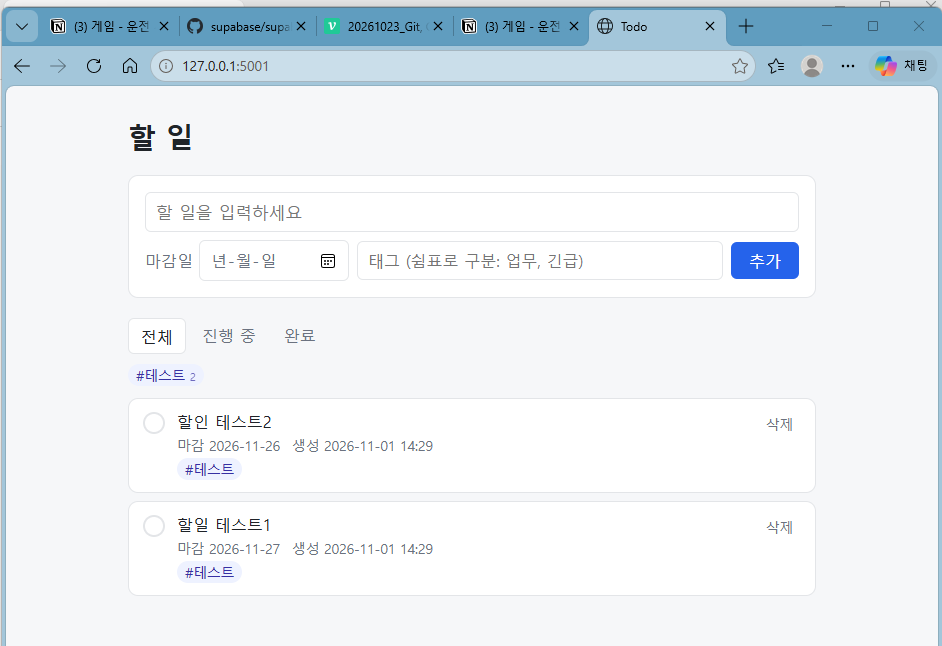 | 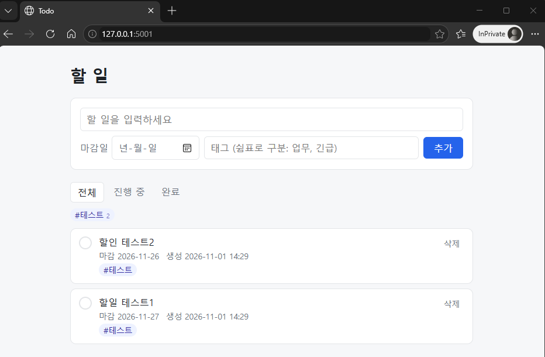 |

### 5-2. Supabase: 클라우드 DB에 저장된 행

Supabase 대시보드 **Table Editor → todos**입니다. 앱에서 넣은 할 일이 클라우드 DB에 저장되어 있고, 행마다 소유자 `user_id`가 기록되어 있습니다. 사용자마다 `user_id`가 다릅니다. 오른쪽 위의 **4 RLS policies**는 이 테이블에 정책 4개가 걸려 있다는 뜻입니다.

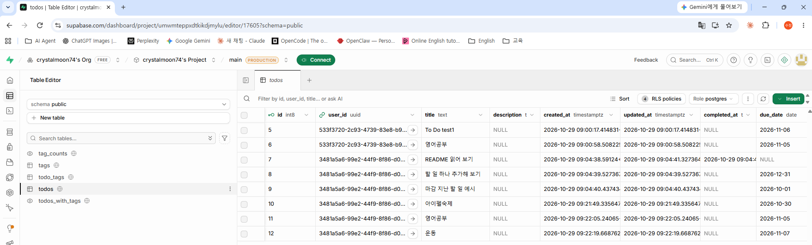

### 5-3. Supabase: RLS 정책

Supabase 대시보드 **Database → Policies**입니다.
- 세 테이블(`tags`, `todo_tags`, `todos`)에 모두 RLS가 켜져 있습니다. 켜져 있어서 오른쪽 위 버튼이 **Disable RLS**로 보입니다.
- 정책은 [db/schema.sql](db/schema.sql)과 같고, 모두 `authenticated`(로그인한 사용자)에만 적용됩니다.
- 테이블 이름 옆의 **API DISABLED** 표시는 로그인 안 한 사용자(`anon`)의 테이블 권한을 회수(`revoke`)해서 나타나는 표시입니다. 의도한 이중 잠금이고, 로그인한 사용자는 정상적으로 씁니다 (위 4장 시험 결과 참고).

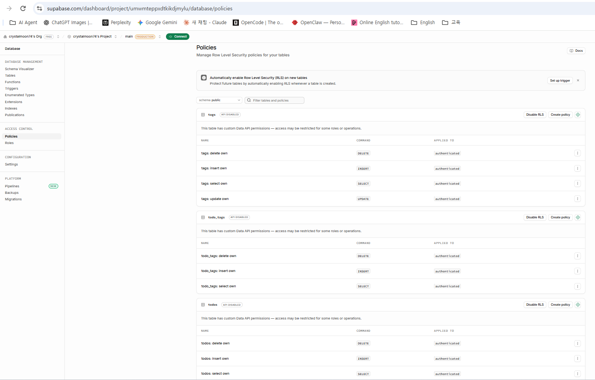

### 5-4. 배포 사이트

https://todos-g3b4.onrender.com/ 에 데모 계정으로 로그인한 화면입니다. Table Editor에 보이는 행들(영어공부, 아이펠숙제, 운동 등)이 같은 사용자의 화면에 나옵니다. 마감 지난 할 일은 빨간색으로 강조됩니다.

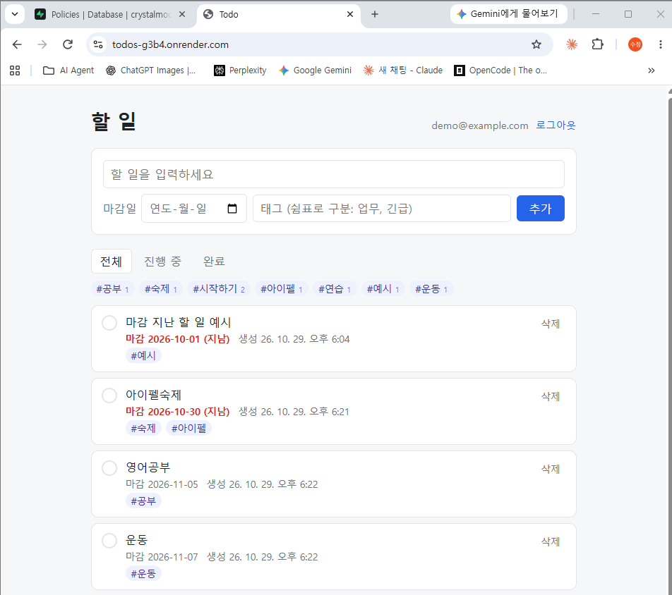

## 6. 로컬 CLI(todo_cli.py) 확인

확인 날짜: 2026-11-02

**대상:** [local-sqlite/todo_cli.py](local-sqlite/todo_cli.py) (AI·터미널에서 할 일을 다루는 명령줄 도구. 웹 앱과 같은 `todo.db`를 사용)

**방법:** [tests/verify_cli.py](tests/verify_cli.py)가 아래 순서로 **CLI를 실제 프로세스로 실행**하고 출력·종료 코드를 확인합니다.
1. `local-sqlite/`를 임시 폴더에 복사 (`todo.db`는 빼고 복사해 빈 DB에서 시작)
2. `list` → `add` 2건(마감일·태그, 중복 태그 포함) → 잘못된 입력 2건(빈 제목, 없는 날짜 `2026-13-40`)
3. `done` 정상 1건 → 같은 번호 다시 `done` → 없는 번호 `done 99`
4. `list`, `summary` 출력이 기대한 문구와 같은지 비교
5. 복사본 `todo.db`를 직접 열어 저장된 행 확인
6. 복사본의 웹 앱(`app.py`)으로 `/` 화면을 열어 CLI로 넣은 할 일이 보이는지 확인
7. 실행 전후 내 `local-sqlite/todo.db`의 해시를 비교해 실데이터가 바뀌지 않았는지 확인

**결과:** ✅ 15/15 통과

```
== 2. 추가 ==
  $ todo_cli.py add 보고서 작성 --due 2026-11-05 --tags 업무, 긴급,업무   (종료 코드 0)
    추가했습니다: 1. 보고서 작성
  $ todo_cli.py add       (종료 코드 1)
    제목을 입력해 주세요.
  $ todo_cli.py add 잘못된 마감 --due 2026-13-40   (종료 코드 1)
    입력값이 올바르지 않습니다. 마감일 형식(YYYY-MM-DD)을 확인해 주세요.

== 3. 완료 ==
  $ todo_cli.py done 2   (종료 코드 0)
    완료했습니다: 2. 운동하기
  $ todo_cli.py done 2   (종료 코드 0)
    이미 완료된 할 일입니다: 2. 운동하기
  $ todo_cli.py done 99   (종료 코드 1)
    99번 할 일이 없습니다.

== 4. 목록 / 요약 ==
  $ todo_cli.py list   (종료 코드 0)
    [ ] 1. 보고서 작성  (마감 2026-11-05)  #업무, 긴급
    [x] 2. 운동하기  #건강
  $ todo_cli.py summary   (종료 코드 0)
    오늘(2026-11-02) 완료 1건 / 남은 할 일 1건
    - 2. 운동하기 (16:33)

== 5. DB 내용 ==
  [todo.db: id, 제목, 마감일, 완료 여부, 태그]
    (1, '보고서 작성', '2026-11-05', 0, '업무, 긴급')
    (2, '운동하기', None, 1, '건강')

== 6. 웹 화면과 같은 DB 사용 ==
PASS CLI로 추가한 할 일이 웹 화면(/)에 보임

== 7. 실데이터 보호 ==
PASS 내 local-sqlite/todo.db 변경 없음

15/15 passed
```

(핵심 부분만 옮겼습니다. 전체 출력은 [docs/results/verify_cli.txt](docs/results/verify_cli.txt)에 있습니다.)

- `list`의 `[ ]`는 미완료, `[x]`는 완료입니다. 미완료가 먼저, 그다음 마감일 순으로 나옵니다.
- 태그를 `업무, 긴급,업무`로 넣어도 `업무`는 한 번만 저장됩니다 (웹 앱과 같은 `parse_tags` 사용).
- 잘못된 입력과 없는 번호는 **종료 코드 1**로 끝나고 DB에 저장되지 않습니다 (5번에서 2건만 남음).
- `summary`의 시각(`16:33`)은 DB의 UTC 시각을 내 컴퓨터 시간으로 바꾼 값입니다. "오늘"도 내 컴퓨터 날짜 기준으로 판단합니다.

## 7. AI가 CLI·스킬로 내 데이터 읽기 (화면 캡처)

캡처 날짜: 2026-11-02

**대상:** 프로젝트 루트(`C:\aiagent\todo`)에서 실행한 Claude Code CLI. 사용법은 [CLAUDE.md](CLAUDE.md), 스킬은 [.claude/skills/](.claude/skills/)에 있습니다.

**방법:**
1. 대화를 새로 열 때마다 아래 요청을 한마디씩 보냅니다. 명령이나 파일 위치는 따로 알려 주지 않습니다.
2. AI가 실행하려는 명령과 승인창을 확인합니다. 읽기는 허용하고, 연습용 파일 삭제는 거부합니다.

**결과 요약**
| 요청 | AI가 한 일 | 결과 |
|---|---|---|
| "이 프로젝트 어떻게 실행해?" | CLAUDE.md에 적은 `todo_cli.py` 명령으로 안내 | ✅ 규칙 파일을 읽음 |
| "Todo 항목 summary 부탁해" | `summary`를 직접 실행해 실제 할 일을 표로 정리 | ✅ 소스가 아니라 데이터를 읽음 |
| "오늘 할 일 목록을 보여 줘" | `list` 실행 전 승인창 표시 | ✅ 허용 후 실행 |
| "연습용-삭제해도-됨.txt만 지워 줘" | `Remove-Item` 실행 전 승인창 표시 | ✅ 거부, 파일 그대로 남음 |
| "요약 스킬 써서 오늘 한 일 정리해 줘" | `todo-summary` 스킬 발동 → CLI 실행 → 커밋 메시지 형식으로 출력 | ✅ |
| "오늘 만든 todo_cli.py 확인 결과를 검증 기록에 추가해 줘" | `verification-record` 스킬 발동 → 확인 스크립트 작성·실행 → 6장 추가 | ✅ |

### 7-1. 규칙 파일(CLAUDE.md)을 읽고 답하기

새 대화에서 "이 프로젝트 어떻게 실행해?"라고만 물었습니다. 아래쪽 **2. 로컬 SQLite 버전**에 CLAUDE.md에 적은 `local-sqlite\todo_cli.py` 명령 4개가 그대로 나옵니다.

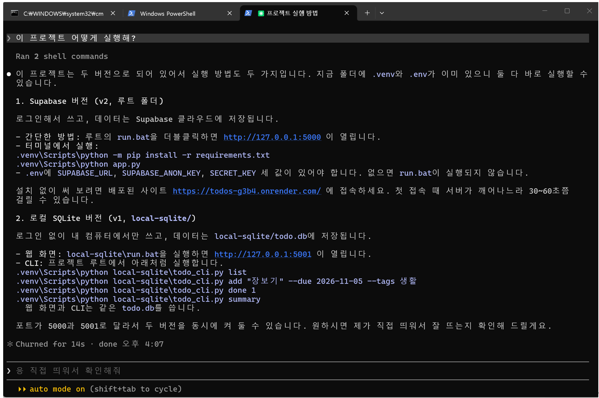

### 7-2. AI가 CLI를 직접 실행해 데이터 읽기

"Todo 항목 summary 부탁해"라고 하자 **Ran 1 shell command**로 CLI를 실행하고, 실제 `todo.db`에 있는 할 일 2건을 표로 정리했습니다. 복사·붙여넣기 없이 AI가 앱을 직접 돌린 결과입니다.

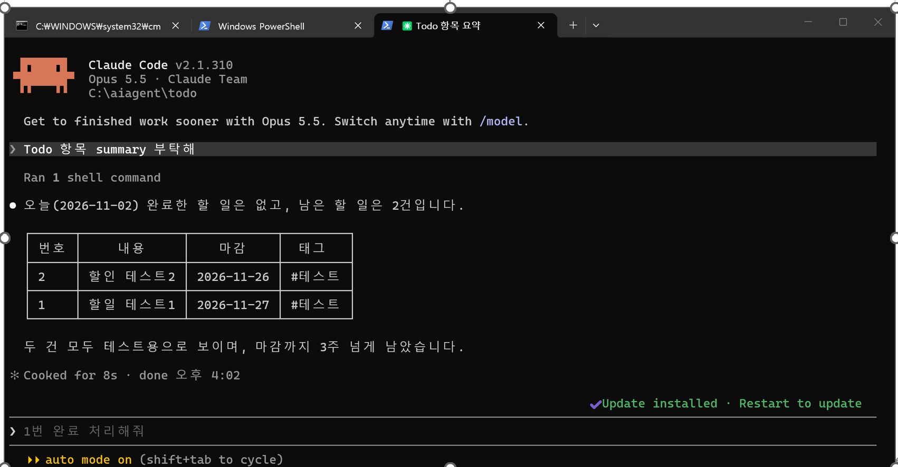

### 7-3. 권한 승인창

| 읽기: `list` 실행 전 | 삭제: 연습용 파일 지우기 전 |
|---|---|
| 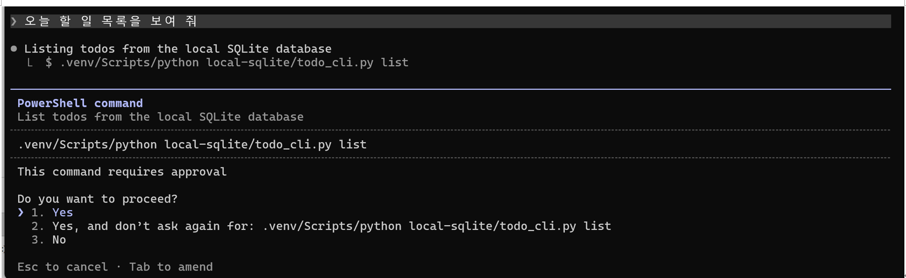 | 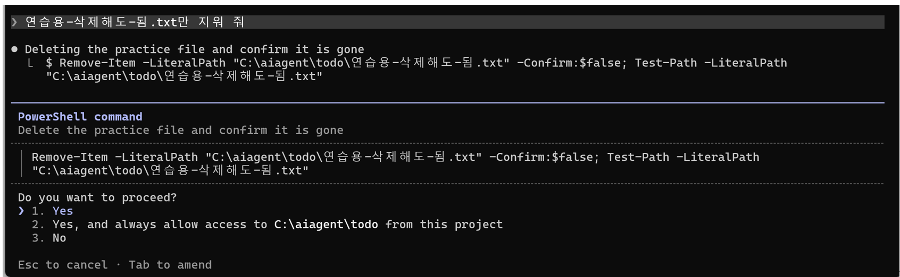 |
| 실행할 명령(`todo_cli.py list`)이 그대로 보입니다. **Yes**로 허용했습니다. 2번을 고르면 다음부터 이 명령은 묻지 않습니다. | 삭제 대상이 `연습용-삭제해도-됨.txt` 하나인지 확인한 뒤 **No**로 거부했습니다. 실습 뒤에도 파일이 남아 있습니다. 실제 `todo.db`는 삭제 연습 대상으로 쓰지 않았습니다. |

### 7-4. 스킬을 한마디로 발동

| `todo-summary` | `verification-record` |
|---|---|
| 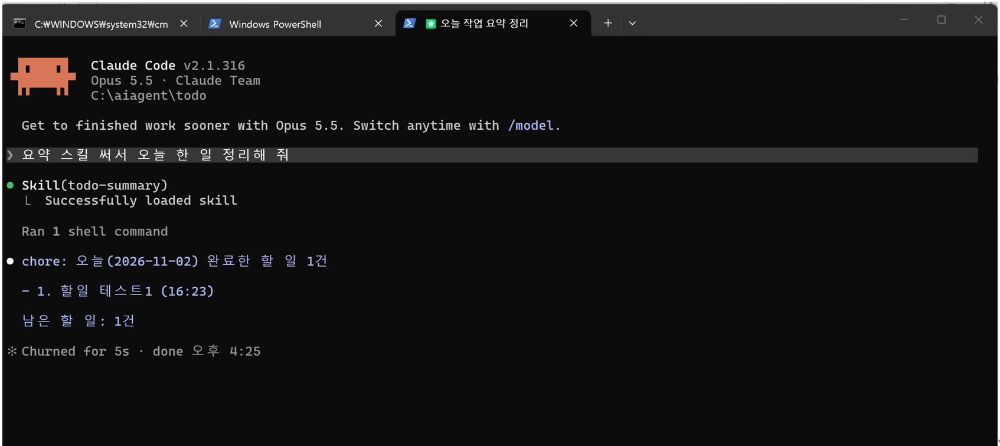 | 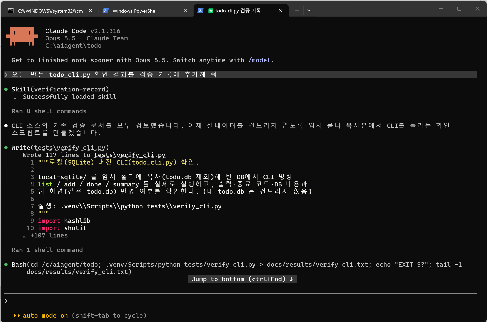 |
| "요약 스킬 써서 오늘 한 일 정리해 줘" → **Skill(todo-summary)**가 불리고, CLI 결과가 `chore: 오늘(2026-11-02) 완료한 할 일 1건` 형식으로 정리됩니다. | "오늘 만든 todo_cli.py 확인 결과를 검증 기록에 추가해 줘" → **Skill(verification-record)**가 불리고, 확인 스크립트 [tests/verify_cli.py](tests/verify_cli.py)를 만들어 실행한 뒤 이 문서의 6장을 썼습니다. |

**관찰한 점**
- 같은 데이터를 두 번 읽었는데, 7-2(16:02)에는 오늘 완료 0건이고 7-4(16:25)에는 1건입니다. 그 사이에 1번 할 일을 완료했기 때문입니다.
- 스킬은 데이터를 직접 열지 않고, 두 경우 모두 CLI(`todo_cli.py`)를 거쳐 읽었습니다.

## 다시 확인하는 방법

```
.venv\Scripts\python tests\verify_local.py
.venv\Scripts\python tests\verify_supabase.py
.venv\Scripts\python tests\verify_cli.py
```

- `verify_local.py`는 v1 앱을 임시 폴더에 복사해서 확인하므로 내 `todo.db`를 건드리지 않습니다.
- `verify_cli.py`도 임시 폴더 복사본(빈 DB)에서 CLI를 실행하므로 내 `todo.db`를 건드리지 않습니다. 실행 전후 해시 비교로 이를 직접 확인합니다.
- `verify_supabase.py`는 `.env`의 Supabase 설정을 씁니다. 실행할 때마다 테스트 사용자 2명(`todo-test-*@example.com`)이 생기고, 할 일 데이터는 끝에 지웁니다. 테스트 사용자는 대시보드 **Authentication → Users**에서 지울 수 있습니다. *Confirm email*이 켜져 있으면 끄고 실행해 주세요.
